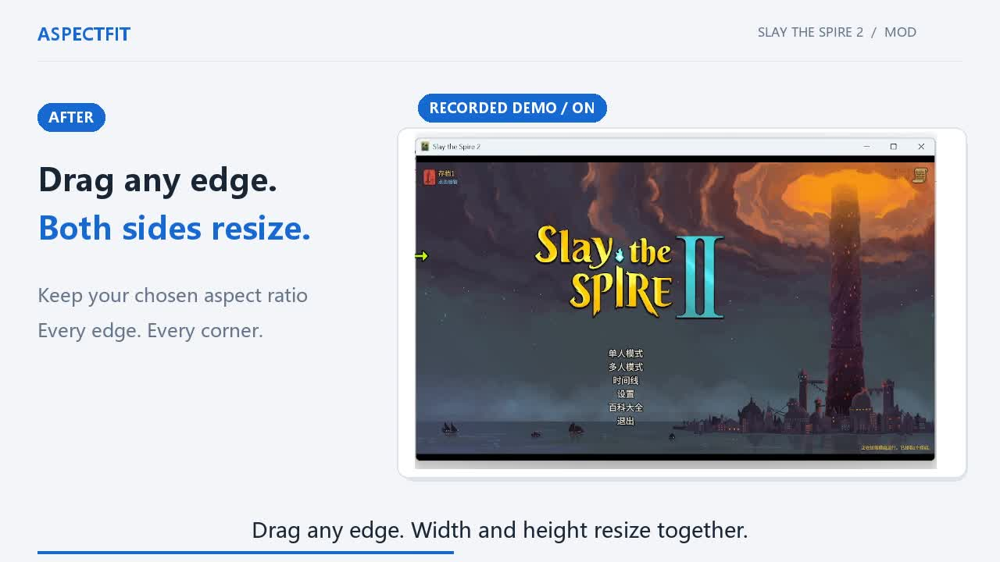

# 随窗而变 · AspectFit

Resize your Slay the Spire 2 window in proportion. Drag any edge or corner; width and height adjust together.

《杀戮尖塔 2》Windows 窗口等比缩放 Mod。拖一条边，宽高一起变。



[Steam Workshop / 创意工坊](https://steamcommunity.com/sharedfiles/filedetails/?id=3839427647) · [English demo](media/demo-en.mp4) · [中文演示](media/demo-zh.mp4)

## Install / 安装

Subscribe through Steam Workshop, enable the mod in-game, and restart. Alternatively, close the game and copy this repository's `mods/AspectWindow` directory into the game's `mods` directory. Avoid installing duplicate copies through both methods.

在创意工坊订阅后，在游戏内启用 Mod 并重启。也可以退出游戏，将本仓库的 `mods/AspectWindow` 文件夹复制到游戏的 `mods` 文件夹。两种安装方式选一种，避免重复加载。

Use Windows windowed mode with window resizing enabled. Select the desired aspect ratio in the game's video settings, then drag an edge or corner.

关闭全屏模式、启用窗口缩放，在游戏视频设置中选择画面宽高比，拖动任意边缘或角落即可。

## Behavior / 行为

- Preserves the client-area aspect ratio; window borders and the title bar are excluded.
- Supports all four edges and corners; respects the game's minimum window size.
- Uses the game's selected aspect ratio. Auto uses the saved/selected window resolution ratio.
- Does not constrain fullscreen or maximized windows, change gameplay, or provide a hide-window hotkey.
- Internal mod ID and assembly name remain `AspectWindow`.

按游戏客户区计算比例，不包含标题栏和边框；遵守最小尺寸约束。“自动”使用保存或选择的窗口分辨率比例。全屏、最大化窗口不受拖动约束。像素取整可能产生约一像素误差。本 Mod 不提供老板键或一键隐藏功能。

## Build / 构建

Requires .NET 9 SDK and a locally installed Windows copy of Slay the Spire 2. Game assemblies are referenced locally and are not distributed here.

```powershell
dotnet build source/AspectWindow.csproj -c Release -p:GameDir="D:\Steam\steamapps\common\Slay the Spire 2"
dotnet run --project source/tests/GeometryTests.csproj
```

The DLL is produced in `source/bin/Release/net9.0/AspectWindow.dll`.

## Compatibility / 兼容性

Version 1.0.0 was tested against game v0.113.0 on Windows x64. Geometry tests cover all eight resize directions, anchors, minimum dimensions, aspect ratios, border offsets, and negative coordinates. Multi-monitor configurations have not all been manually tested. Later game versions may require updates.

Uses the built-in mod loader and `SetWindowSubclass` / `WM_SIZING` on the Godot main thread. No polling or replacement of original game files.

## Reporting issues / 反馈

Please include your game version, Windows display scaling, selected aspect ratio, resolution, and reproduction steps.

反馈时请附上游戏版本、Windows 缩放比例、画面宽高比、分辨率和复现步骤。

Game art and trademarks belong to their respective owners. This is a community-made mod.
